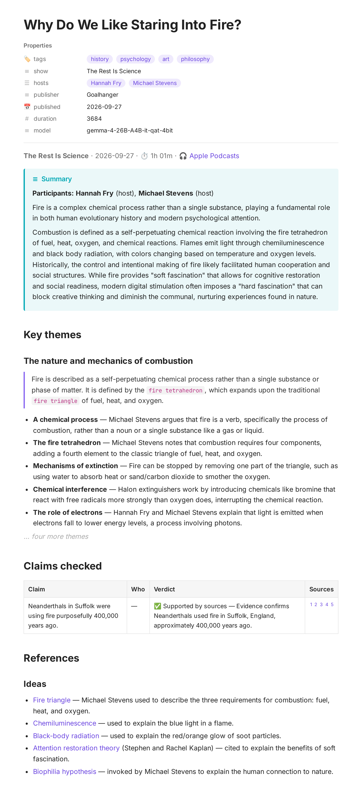
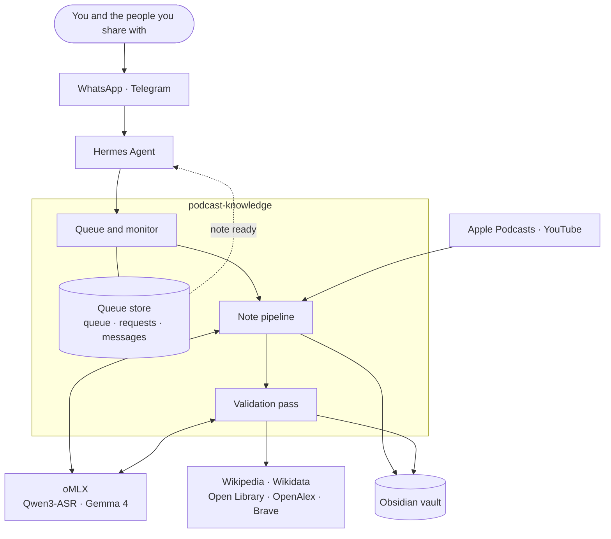
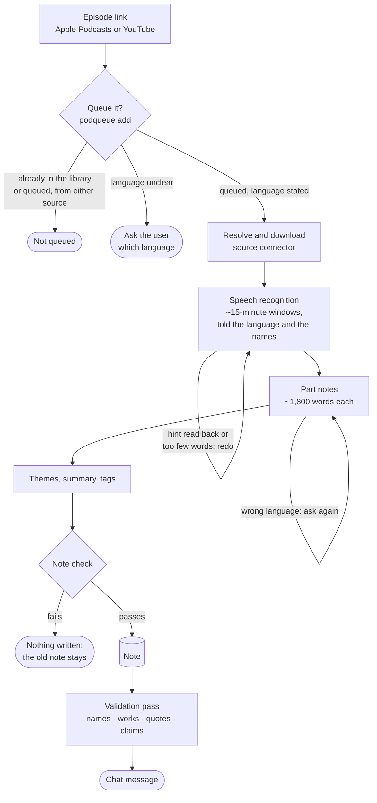
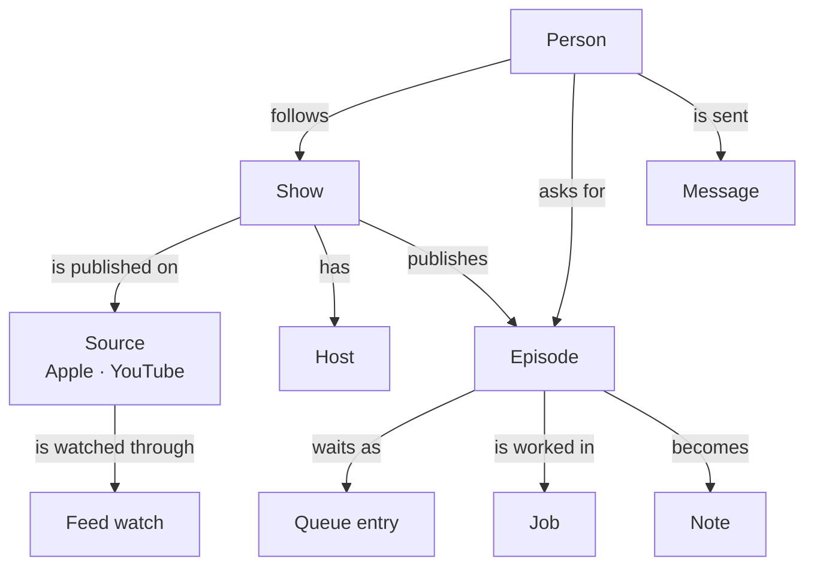

<p align="center">
  
  &nbsp;&nbsp;
  
  &nbsp;&nbsp;&nbsp;➜&nbsp;&nbsp;&nbsp;
  
</p>

<h1 align="center">podcast-knowledge</h1>

<p align="center">
  <b>Every episode you follow becomes a note you keep.</b><br>
  Who spoke, what they argued, which claims hold up, and the books and ideas they cited:<br>
  written in the episode's own language, on your own hardware, delivered to your chat.
</p>

<p align="center">
  <a href="#key-features">Key features</a> ·
  <a href="#new-in-60">New in 6.0</a> ·
  <a href="#what-it-looks-like">What it looks like</a> ·
  <a href="#architecture">Architecture</a> ·
  <a href="#installation">Installation</a>
</p>

## Built with

A set-up that has been run end to end. Each part does one job, and the scripts work without the optional ones.

| | product | role | |
| :---: | --- | --- | --- |
|   | **Apple Podcasts** and **YouTube** | where episodes come from; a podcast can have both, each with a priority | sources |
|   | **WhatsApp** and **Telegram** | send a link, follow a show, get each finished note as a short message | chat |
| 🤖 | **[Hermes Agent](https://hermes-agent.nousresearch.com)** | takes links from chat, runs the scheduled jobs, sends the messages | agent, optional |
|  | **[Obsidian](https://obsidian.md)** | where the notes live: a vault you can search, link and sync to every device | library |
|  | **[oMLX](https://github.com/jundot/omlx)** on Apple Silicon | runs both models locally, one at a time | model server |
|  | **Qwen3-ASR 1.7B** | speech recognition, told each episode's language and the speakers' names | recommended model |
|  | **Gemma 4 26B A4B** | writes and checks the notes; a mixture of experts that fits a 24 GB Mac | recommended model |

Tested on a 24 GB Apple Silicon Mac. Other hardware and models can work; see [Models](docs/MANUAL.md#models).

## Key features

| | |
| --- | --- |
| 🏠 **Private by design**<br>Speech recognition and writing run on your own model server. No audio or transcript leaves your network. | 📚 **Knowledge that accumulates**<br>One note per episode, one folder per show, a table of every episode for Obsidian, and a show registry that learns each show's hosts. |
| 🔔 **Never miss a release**<br>Follow a show and its new episodes are picked up from Apple and YouTube, made once, and sent to you. | 🎯 **The point in a minute**<br>A one-line take, a short summary and the key themes, each point credited to whoever made it. |
| ✅ **Checked against sources**<br>Claims are checked against Wikipedia, Wikidata, OpenAlex and web search, and only cited evidence gives a verdict. Books, ideas and quotes are linked and matched. | 🌍 **Any language**<br>The note is written in the episode's own language, and an unclear language is asked about rather than guessed. |
| 👪 **Share with family and friends**<br>People you let in follow shows and queue episodes from their own chat. You keep control of shows and people. | 🛡️ **Runs itself**<br>Long episodes resume, failures are retried, and a crash loses no note or message. A health check flags a source gone quiet. |

## New in 6.0

- **YouTube** joins Apple Podcasts. A podcast can have both, with priorities, and each episode is made once.
- **Every episode in its own language**, from speech recognition to the finished note.
- **Several people** on one installation, each with their own shows and messages.
- **Crash-safe bookkeeping**, so a queued episode or a message is never lost.
- **Health at a glance**, plus a check after every Hermes upgrade.

[All the changes ↓](#whats-new-in-60)

## What it looks like

A real note, from *The Rest Is Science*,
["Why Do We Like Staring Into Fire?"](https://podcasts.apple.com/gb/podcast/the-rest-is-science/id1853007888?i=1000791914284)
with [Hannah Fry](https://x.com/FryRsquared) and [Michael Stevens](https://x.com/tweetsauce): an hour of conversation,
read in a few minutes.

<p align="center">
  <picture>
    <source media="(prefers-color-scheme: dark)" srcset="docs/images/example-note-dark.png">
    
  </picture>
</p>

**Every note follows one template:**

| section | what you get |
| --- | --- |
| **Header** | show · date · length · a link back to the episode |
| **Summary** | who took part (hosts, then guests), the one-line take, and a short paragraph on where the conversation lands |
| **Key themes** | 3 to 8 themes in episode order, each with its essence and one bullet per point, saying who made it |
| **Claims checked** | ✅ supported or ⚠️ disputed, each with its sources; claims with no verdict are left out |
| **References** | books, films, papers, laws, ideas and quotes, linked to Open Library or Wikipedia and matched to what was said |
| **Properties** | show, episode, date, hosts, guests, language, duration and tags, ready for Obsidian Bases |

<details>
<summary>The same note as Markdown</summary>

```markdown
---
origin: agent
model: gemma-4-26B-A4B-it-qat-4bit
created: "2026-10-09T02:57:31"
updated: "2026-10-16T16:03:12"
tags: [history, psychology, art, philosophy]
show: "The Rest Is Science"
episode: "Why Do We Like Staring Into Fire?"
published: "2026-09-27T21:00:00"
hosts: ["Hannah Fry", "Michael Stevens"]
publisher: "Goalhanger"
source_url: https://podcasts.apple.com/gb/podcast/the-rest-is-science/id1853007888?i=1000791914284
apple_episode_id: '1000791914284'
duration: 3684
---
# Why Do We Like Staring Into Fire?

**The Rest Is Science** · 2026-09-27 · ⏱ 1h 01m · 🎧 [Apple Podcasts](https://podcasts.apple.com/gb/podcast/the-rest-is-science/id1853007888?i=1000791914284)

> [!abstract] Summary
> **Participants:** **Hannah Fry** (host), **Michael Stevens** (host)
>
> Fire is a complex chemical process rather than a single substance, playing a fundamental role in both human evolutionary history and modern psychological attention.
>
> Combustion is defined as a self-perpetuating chemical reaction involving the fire tetrahedron of fuel, heat, oxygen, and chemical reactions. Flames emit light through chemiluminescence and black body radiation, with colors changing based on temperature and oxygen levels. Historically, the control and intentional making of fire likely facilitated human cooperation and social structures. While fire provides "soft fascination" that allows for cognitive restoration and social readiness, modern digital stimulation often imposes a "hard fascination" that can block creative thinking and diminish the communal, nurturing experiences found in nature.

## Key themes

### The nature and mechanics of combustion
> Fire is described as a self-perpetuating chemical process rather than a single substance or phase of matter. It is defined by the `fire tetrahedron`, which expands upon the traditional `fire triangle` of fuel, heat, and oxygen.

- **A chemical process** — Michael Stevens argues that fire is a verb, specifically the process of combustion, rather than a noun or a single substance like a gas or liquid.
- **The fire tetrahedron** — Michael Stevens notes that combustion requires four components, adding a fourth element to the classic triangle of fuel, heat, and oxygen.
- **Mechanisms of extinction** — Fire can be stopped by removing one part of the triangle, such as using water to absorb heat or sand/carbon dioxide to smother the oxygen.
…

## Claims checked

| Claim | Who | Verdict | Sources |
| --- | --- | --- | --- |
| Neanderthals in Suffolk were using fire purposefully 400,000 years ago. | — | ✅ Supported by sources — Evidence confirms Neanderthals used fire in Suffolk, England, approximately 400,000 years ago. | [^1] [^2] [^3] [^4] [^5] |

## References

### Ideas
- [Fire triangle](https://en.wikipedia.org/wiki/Fire_triangle) — Michael Stevens used to describe the three requirements for combustion: fuel, heat, and oxygen.
- [Attention restoration theory](https://en.wikipedia.org/wiki/Attention_restoration_theory) (Stephen and Rachel Kaplan) — cited to explain the benefits of soft fascination.
…
```

</details>

**In your chat** as soon as the note is ready, on WhatsApp or Telegram (the real message for this episode):

> 💬 **podcast-knowledge** · WhatsApp
>
> 🟢 **The Rest Is Science: Why Do We Like Staring Into Fire?**  
> *Hannah Fry (host), Michael Stevens (host)*
>
> > Fire is a complex chemical process rather than a single substance, playing a fundamental role in both human evolutionary history and modern psychological attention.
>
> https://podcasts.apple.com/gb/podcast/the-rest-is-science/id1853007888?i=1000791914284
>
> **Key themes**  
> • **The nature and mechanics of combustion**  
> &nbsp;&nbsp;&nbsp;– A chemical process  
> &nbsp;&nbsp;&nbsp;– The fire tetrahedron  
> &nbsp;&nbsp;&nbsp;– Mechanisms of extinction  
> &nbsp;&nbsp;&nbsp;– Chemical interference  
> &nbsp;&nbsp;&nbsp;– The role of electrons  
> • **The chemistry of flames and light**  
> &nbsp;&nbsp;&nbsp;– Flame coloration and soot  
> &nbsp;&nbsp;&nbsp;– Thermal radiation  
> &nbsp;&nbsp;&nbsp;– Phase composition  
> &nbsp;&nbsp;&nbsp;– Oxygen and plasma  
> &nbsp;&nbsp;&nbsp;– The dark zone  
> • **Evolutionary history and human use of fire**  
> &nbsp;&nbsp;&nbsp;– Atmospheric oxygen  
> &nbsp;&nbsp;&nbsp;– Ancient wildfires  
> &nbsp;&nbsp;&nbsp;– Human control of fire  
> &nbsp;&nbsp;&nbsp;– Intentional fire making  
> &nbsp;&nbsp;&nbsp;– Social and biological impact  
> • … two more themes, each with its points

## Architecture

The moving parts, and how one episode travels through them.

### The pieces



| component | role | required |
| --- | --- | --- |
| the scripts (this repository) | queue, sources, transcription, synthesis, validation | yes |
| model server | serves the speech-recognition and text models over an HTTP API | yes |
| notes folder | where notes are written; any folder the scripts can write to | yes |
| state and cache folders | the queue's store, show registry, monitor state and logs; transcripts and working files per episode | yes (two folders) |
| speech-detection runtime | Silero VAD in its own small venv, built by `scripts/setup_vad.py`; the model is bundled | yes |
| yt-dlp | resolves YouTube videos (in a venv of its own, with Node.js or Deno) | for YouTube |
| [Hermes agent](https://hermes-agent.nousresearch.com) | takes links from chat, runs the scheduled jobs, sends the messages | optional |
| web services | evidence for the validation pass | Wikipedia, Wikidata, Open Library, OpenAlex: no key; Brave Search: optional key |

- **Placement** — the pieces can share one machine or be spread across a network: the agent and scripts on an always-on computer, the model server on a machine with a capable GPU or unified memory, the notes folder synced to your devices.
- **No GPU for the scripts** — they download audio, cut it and move text.
- **No agent needed** — the scripts run the same from a shell or any scheduler.

### One episode, step by step



- **Resumable** — every stage keeps its results on disk; a stopped run (a timeout, the model server gone) resumes where it was, without redoing downloaded audio, transcribed windows or finished part notes.

### Data model



| folder | holds | private |
| --- | --- | --- |
| state (`PODNOTE_STATE`) | people, shows, the queue's store, monitor state, logs, your `names.txt` | yes |
| cache (`PODNOTE_CACHE`) | one working folder per episode, cleaned after `PODNOTE_KEEP_DAYS` | yes |
| notes (`PODNOTE_ROOT`) | the notes: the only output meant to be read | yours |

**Where each entity lives, one of what, and who writes it:**

| entity | stored in | one entry is | written by | kept |
| --- | --- | --- | --- | --- |
| person | `users.json` (mode 600) | one person, by a short name (`robin`) | `podusers.py`, the agent, `users.current` for a newcomer | until removed |
| identity | inside a person | one `platform:id`, normalised (every WhatsApp form becomes the number) | `podusers.py identity` | with the person |
| show | `shows.json` | one show: its Apple show id, or `yt:<channel id>` | `podshows.py` | always (episodes are its notes) |
| source | inside a show | one platform of one show | `podshows.py link`, `priority` | with the show |
| host | inside a show | one person in one role on one show | the registry's evidence rules, or you (locked) | always; former hosts keep an end date |
| queue entry | `app.sqlite3`, table `jobs` | one queued link (the episode's clean link) | `podqueue.py` | until made, failed or removed |
| request | `app.sqlite3`, table `requests` | one time a person asked for an episode | `podqueue.py` | always; nothing prunes it yet |
| message | `app.sqlite3`, table `outbox` | one message to one person | `podqueue.py` | always; nothing prunes it yet |
| feed watch | `monitor-state.json` | one watched feed, playlist or channel: the Apple show id, or `youtube:<playlist or channel id>` | `podmonitor.py` | while the show is followed |
| job | `PODNOTE_CACHE/jobs/<job id>/` | one source copy of an episode: `podcast-<id>` or `youtube-<id>` | `podnote.py`, `podverify.py` | `PODNOTE_KEEP_DAYS` after last use |
| ASR window | `asr-state.sqlite3` | one transcription window of a job | the transcription layer | with the job |
| note | `PODNOTE_ROOT/PODNOTE_NOTES_DIR/<show>/<date> - <title>.md` | one episode; other copies go to `<state>/superseded-notes/` | `podnote.py`, `podverify.py` | yours |

- **Phone numbers and chat ids** live only in `users.json`; never in a note, `Shows.md` or a log.

## Prerequisites

| need | what | notes |
| --- | --- | --- |
| required | Python 3.11+ and `ffmpeg` (with `ffprobe`) | on the machine that runs the scripts |
| required | a model server with a speech and a text model | see [Models](docs/MANUAL.md#models) |
| required | a notes folder, a state folder and a cache folder | the cache holds about 0.5–1 MB of text per episode; audio only while it is transcribed |
| required | network access to Apple Podcasts | catalogue, feeds, audio |
| for YouTube | [yt-dlp](https://github.com/yt-dlp/yt-dlp) in its own venv, with Node.js or Deno | see [YouTube](docs/MANUAL.md#youtube) |
| optional | [Hermes agent](https://hermes-agent.nousresearch.com) | queueing from chat, scheduled jobs, messages on any channel it supports |
| optional | a [Brave Search API](https://brave.com/search/api/) key | web evidence for claims, the real names of cited books |
| optional | Wikipedia, Wikidata, Open Library, OpenAlex | without them the validation pass does less; notes are still written |
| optional | a metadata standard of your own in the notes folder | see [Notes: format and checks](docs/MANUAL.md#notes-format-and-checks) |

| file | what it installs | where |
| --- | --- | --- |
| `requirements.txt` | `requests`, `jsonschema`, `PyYAML` | the Python that runs the scripts |
| `requirements-vad.txt` | `onnxruntime`, `numpy` | the speech-detection venv; `scripts/setup_vad.py` installs it |
| `requirements-dev.txt` | the above plus `pytest` | only for running the tests |

## Installation

Run these on the machine that will run the scripts.

1. **Code and packages.**

   ```bash
   git clone https://github.com/alexgranford/podcast-knowledge.git && cd podcast-knowledge
   python3 -m pip install -r requirements.txt
   ffmpeg -version                                # must work; install ffmpeg first if it does not
   ```

2. **Model server.**
   - Run it where the scripts can reach it, with an API key, and the speech and text models available.
   - With oMLX the skill loads and unloads the models itself, one at a time, so both fit in memory.
   - Plain `http://` is accepted only for a private or loopback address; anything else needs `https://`.
3. **Settings** (see [Configuration](docs/MANUAL.md#configuration); under Hermes they go in Hermes's own `.env` instead).

   ```bash
   cp .env.example .env && chmod 600 .env
   cp names.example.txt "$PODNOTE_STATE/names.txt"   # optional: your own fixes for misheard names
   ```

4. **Speech-detection runtime:** `python3 scripts/setup_vad.py`.
   - Installs `requirements-vad.txt` into its own venv and self-tests the bundled Silero model.
   - Writes `READY.json` with checksums of the model, `scripts/podcast_vad.py`, the window policy and the installed versions.
   - Transcription checks that record before every job, and stops with "VAD runtime readiness/hash validation failed" after an update that changed one of them: run the script again.
5. **For YouTube:** yt-dlp in a venv of its own, and `PODNOTE_YTDLP` pointing at it.

   ```bash
   python3 -m venv /path/to/yt-dlp && /path/to/yt-dlp/bin/pip install "yt-dlp[default]"
   # .env: PODNOTE_YTDLP=/path/to/yt-dlp/bin/yt-dlp
   ```

6. **Run the tests** before the first episode (see [Testing and validation](docs/MANUAL.md#testing-and-validation)).

### Running under Hermes

Hermes takes links from chat, runs the scheduled jobs and sends the messages.

1. **Install the skill** in Hermes's skills folder, for example `~/.hermes/skills/media/podcast-knowledge/` (in Docker `/opt/data/skills/…`).
   - Install `requirements.txt` into the Python Hermes runs tools with: in the Docker image, `/opt/hermes/.venv`.
   - Add the packages and `ffmpeg` to the image, so a rebuild keeps them.
2. **Settings** go in Hermes's `.env`; the skill folder needs none. Hermes rereads it for every cron run, so no restart is needed.
3. **Speech-detection runtime:** build it once, with the same Python (`scripts/setup_vad.py`).
4. **Wrappers:** copy `hermes/` to `~/.hermes/scripts/` (in Docker `/opt/data/scripts/`), and check each with a dry start, which prints the script and Python it would run and runs nothing:

   ```bash
   python3 ~/.hermes/scripts/podcast-queue.py --check
   ```

5. **Cron jobs:** each runs a script with no model and sends its output to `<channel>` (`telegram`, `discord`, `signal`, `platform:chat_id` for WhatsApp, or `origin`); empty output sends nothing.

   ```bash
   hermes cron create "*/5 * * * *" --name podcast-queue --script podcast-queue.py --no-agent --deliver <channel>
   hermes cron create "7,37 * * * *" --name podcast-monitor --script podcast-monitor.py --no-agent --deliver <channel>
   hermes cron create "15 7 * * 1" --name podcast-shows-digest --script podcast-shows-digest.py --no-agent --deliver <channel>
   hermes cron create "40 5 * * 0" --name yt-dlp-update --script yt-dlp-update.py --no-agent --deliver <channel>   # with YouTube
   ```

6. **First link:** send one to Hermes. The agent queues it (see `SKILL.md`) and replies with one line naming the language; a message follows when the note is written or has failed.

**How the wrappers find things:**

- **The skill** — under `~/.hermes/skills/`, or `PODNOTE_SKILL_DIR`.
- **The Python** — `PODNOTE_PYTHON`, else the Docker image's `/opt/hermes/.venv`; Hermes may start cron scripts on its own managed environment, which lacks the skill's packages.
- **The notes folder** — must be mounted into the container when Hermes runs in Docker.

### Updating

```bash
git pull
python3 -m pip install -r requirements.txt
python3 scripts/setup_vad.py                  # only needed if a job reports the readiness check failing
python3 -m pytest -q tests
```

- **Untouched by an update:** settings, `names.txt`, the queue, the show registry and the notes.
- **From before the queue's store:** the first run moves the queue and requests into it one time and keeps the old files as `*.before-store`.
- **Wrappers:** copy `hermes/` again when one changed.
- **After upgrading Hermes:** run `scripts/check_hermes.py`.
- **An installed skill** is not updated by a merged pull request. After copying a change into it, run its tests and confirm the cron runtime uses it:

  ```bash
  python3 scripts/check_install.py --installed <installed-skill-dir> --wrapper <hermes-scripts-dir>/podcast-monitor.py
  ```

  A nonzero exit means the cron runtime still runs different code. The check covers the monitor and the queue, registry and source modules it calls, and confirms by the wrapper's `--check` dry start that the wrapper is this checkout's and starts the installed monitor.

### Your first note

With the model server running and the settings filled in:

1. **Make a note.**

   ```bash
   python3 scripts/podnote.py "https://podcasts.apple.com/us/podcast/<show>/id<id>?i=<episode-id>"
   ```

   Transcription runs at about seven times real time on the reference setup; writing the note takes a few minutes more. It ends with:

   ```
   NOTE: <PODNOTE_ROOT>/Podcasts/<Show>/<date> - <Episode>.md
   STATUS: complete
   ```

2. **Check it against outside sources.**

   ```bash
   python3 scripts/podverify.py "<the note path printed after NOTE:>"
   ```

3. **Hands-off from a chat app:** follow [Running under Hermes](#running-under-hermes).

## What's new in 6.0

**Sources**

- **YouTube as a second source.** Any video link goes through the same queue, transcription and note. A podcast can have an Apple feed and a YouTube channel, each with a priority you set; an episode is made once, from the best source that has it.
- **One episode, recognised across sources**, by title or, for shows that title their uploads differently, by release time and length.
- **New Apple episodes found sooner:** Apple's catalogue is asked fresh each time, so a cached answer can no longer hide a release for a day.
- **Audio not served yet** for an episode under a day old is tried again later instead of failing.

**Languages**

- **Every episode in its own language**, from speech recognition to the note, its claims and its lookups. Which languages work depends on the speech and text models you run.
- **Detected with care:** a clear case is queued, an unclear one is asked about first.

**People**

- **Several people on one installation:** members follow shows and queue episodes from their own chat, up to a daily limit; the admin is told and keeps control of shows and people.
- **A cleaner message** for each finished note, formatted for both WhatsApp and Telegram, with a link back to the episode.

**Reliability**

- **Crash-safe bookkeeping:** the queue, who asked for what and the messages still to send live in one small SQLite store; a message that fails to send is tried again.
- **One set of monitoring rules** for every source, with nothing forgotten when a feed or listing moves on.
- **Health at a glance:** `podstatus.py`, a one-off notice when a source cannot be read for two days, and `check_hermes.py` after a Hermes upgrade.
- **Long episodes** carried across runs, and a speech-model echo of its own hint caught and redone.
- **Safer installation checks:** cron wrappers with a dry start, and a check that the speech runtime matches the code.

## More

- **[Manual](docs/MANUAL.md):** commands, configuration, models, how each part works, data definitions, limitations and troubleshooting.
- **Questions, problems, tested set-ups:** open a GitHub issue.

## Licence

MIT; see [`LICENSE`](LICENSE). The bundled Silero VAD model is MIT-licensed by the Silero Team.
