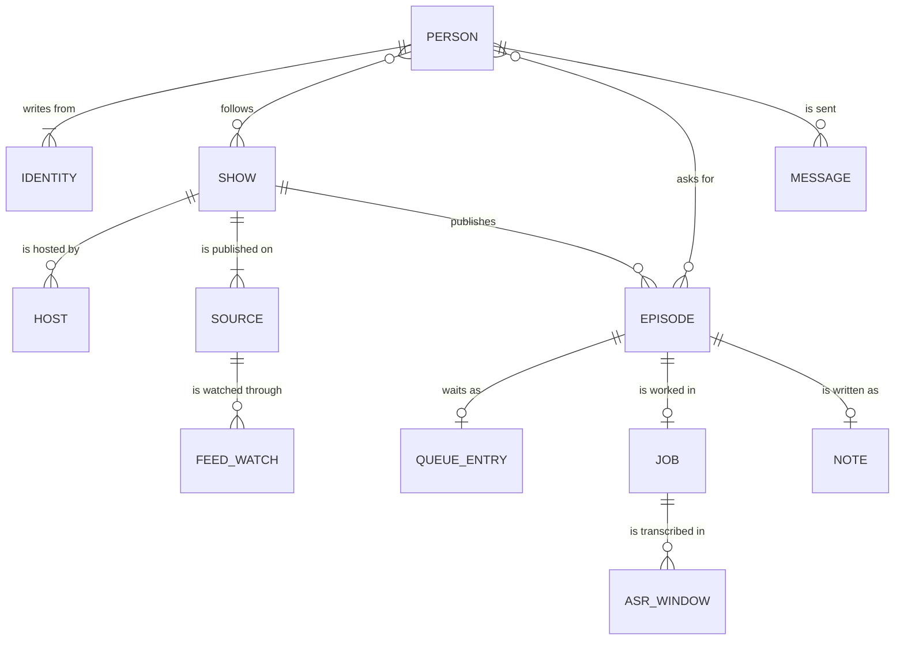

# podcast-knowledge manual

How to run, tune and troubleshoot podcast-knowledge. The [README](../README.md) covers what it is, the architecture and data model, prerequisites and installation.

**Contents:** [Usage](#usage) · [Configuration](#configuration) · [Models](#models) · [How it works](#how-it-works) · [Data definitions](#data-definitions) · [Testing and validation](#testing-and-validation) · [Limitations and failure modes](#limitations-and-failure-modes) · [Repository layout](#repository-layout)

## Usage

### One episode: `podnote.py`

```bash
scripts/podnote.py "<episode-url>"                      # full run: an Apple Podcasts episode or a YouTube video
scripts/podnote.py "<url>" --language <language>        # the episode's language, when it is not clear
scripts/podnote.py --job-dir <dir> --force              # re-make the note from a saved transcript (admin only in a chat)
scripts/podnote.py --job-dir <dir> --force --model X    # the same, on a different model
scripts/podnote.py "<url>" --force --retranscribe       # transcribe again (the earlier transcript set aside)
```

**What it prints** (the contract the queue reads, `scripts/results.py`):

| line | meaning |
| --- | --- |
| `NOTE: <path>` | the note written |
| `STATUS: complete` | written, or already up to date; the only case with exit code 0 |
| `STOPPED: <reason>` | no note written; the old one stays; no traceback |
| `RETRY: later` | that stop is one a later try may fix |
| `EXISTS: <note>` | the episode already has this note |

**Name hints:**

- **What is sent** — every speech window carries the show, its hosts, the names in the title and description, and the cleaned description.
- **Effect** — "Siobhan", "Niamh" and "Maya" come out right instead of "Shivon", "Neeve" and "Maia".
- **Hint read back** — Qwen3-ASR sometimes returns the hint instead of the speech, or before it (about 1 window in 9 on a 236-episode check); the window is transcribed again with a shorter hint, then without one.
- **Record** — each accepted window keeps `asr_hint`: `used`, `used (shorter hint)`, `dropped: <why>` or `none`.

**Caches:**

- **Per job and model** — every model output is kept under `<job>/podnote/<model>/`; a `--job-dir` rerun on the same model makes no model calls.
- **Redo one call** — delete its file; **redo all** — delete the directory.
- **Stale inputs** — the cache records what it was made from (`inputs.sha256`) and is set aside after a new transcript or a prompt change.
- **Retranscribe** — `--retranscribe` moves `asr/` and `podnote/` into `previous-<time>/`, so no transcript is lost; a transcription begun in one language is not resumed in another.

### The queue

podnote makes one episode per run. Hermes cron jobs, in script mode (no model, no cost), run everything around it:

| program | Hermes cron job | what it does |
| --- | --- | --- |
| `scripts/podqueue.py` | `podcast-queue`, every 5 min | runs podnote on the next queued link, then the validation pass; one episode per tick; a chat message per finished or failed episode, silence otherwise |
| `scripts/podmonitor.py` | `podcast-monitor`, at :07 and :37 | checks the followed shows on Apple and YouTube for new episodes and queues them |
| `scripts/podshows.py digest` | `podcast-shows-digest`, Mondays 07:15 | weekly summary of show registry changes (silent when there are none) |
| `scripts/ytdlp_update.py` | `yt-dlp-update`, Sundays 05:40 | upgrades and tests yt-dlp, rolling back a broken release |
| `scripts/podverify.py` | called by the queue | validates names, works, quotes and key claims against external sources |

**Commands:**

| command | what it does |
| --- | --- |
| `podqueue.py add <url> [--language L] [--force]` | checks a link; answers in one line: queued with its language, already queued or in the library (either source), or a language question |
| `podqueue.py list` | the queue, and any messages waiting to go out |
| `podqueue.py remove <position\|link>`, `move <position\|link> <to>` | the admin changes the queue |
| `podqueue.py export` | writes the store back as the files an earlier version reads, for a rollback |

**How it behaves:**

- **One change, one transaction** — admitting an episode and recording who asked is one commit (the daily limit counts it at once); finishing an episode and writing its messages is another (a crash cannot lose them).
- **Messages** — sent after the commit, one at a time; a failed or cut-off send is tried again after 5, 15, 60 and 180 minutes, then given up. An occasional duplicate is accepted; a lost message is not. The admin's copy of a finished note goes the same way. Without a delivery address for the admin, it is the queue job's output.
- **Retries** — a failure a later try may fix is retried 1, 3, 6 and 12 hours after the first failure, then reported:
  - Apple not listing the episode yet;
  - a server or network error;
  - audio not yet served for an episode under a day old;
  - YouTube's bot check, or a premiere;
  - the model server unreachable.

  Anything else (a removed video, a bad link, an incomplete note) is reported at once; the old note stays. Retries are silent.
- **Long episodes** — a run stops podnote at 40 minutes (Hermes allows a script one hour), and transcription runs at about seven times real time, so an episode over about three hours needs several runs. A run stopped by the time limit that saved new work carries on at the next tick, up to six times, without counting as a failure.
- **Validation retries** — a failed pass is retried on its own 1, 3, 6 and 12 hours after its latest try: when the queue has nothing due, or on any tick once six hours late, so a busy queue cannot starve it.
- **Files** — `queue.txt` and `queue-state.json` are read-only exports of the store; `done.txt` and `failed.txt` are logs.
- **Cache** — each episode's folder (`PODNOTE_CACHE/jobs/podcast-<id>/` or `youtube-<id>/`) keeps the transcript, part notes and records. The audio goes when the transcript is complete; the folder after `PODNOTE_KEEP_DAYS` days unused. At most once a day; queued episodes and the notes are never touched.

### Shows and monitoring

**The show registry** (`podshows.py`, `PODNOTE_STATE/shows.json`):

- **Holds** every show ever processed, keyed by its Apple show id, or `yt:<channel id>` for a show only on YouTube.
- **Keeps** facts about the show only: folder, publisher, feed, sources, language, Wikidata item, followers, hosts, name fixes, advertisers. Episodes are the notes in the show's folder.
- **Corrections** go through Hermes: "hosts of X are A, B", "follow X", "X is in <language>", "link X = <channel link>".
- **Logged** in `shows-changes.log` and summarised in the weekly digest; `Shows.md` in the podcasts folder is a generated, read-only overview.

**Hosts maintain themselves from evidence**, without approvals:

| evidence | effect |
| --- | --- |
| you (locked: automatic changes leave it alone), the feed's `podcast:person` host tags, Wikidata's presenter, a full name in the show's title ("Signals with Omar Haddad"), a feed author who is a person | a host at once |
| the notes listing someone as host, or a self-introduction or sign-off ("Thanks for listening. I'm Iris Fleming") | a host after three episodes |
| share of recent episodes (the last 20, or 30 days if longer) | about half or more: regular host; 10–50%: recurring co-host |
| a regular host missing from 8 recent episodes for 60 days, or a co-host missing for three of their usual gaps | former, with an end date; nobody is deleted, older episodes keep their hosts |
| a name the validation pass corrects in two episodes | that show's name fix |
| advertisers named in show notes | kept per show for 90 days and named in the part-note prompt |

**Monitoring** covers the shows someone follows.

| | Apple | YouTube |
| --- | --- | --- |
| reads | the RSS feed, for episodes not seen before | the podcast playlist, Videos and Streams tabs (the newest 15 each) |
| resolves | each episode to Apple's catalogue: by GUID, then enclosure URL, then title, date and duration together; ambiguity rejected | only new videos; a stream still running or a premiere waits until it has ended |
| asks | the newest 10 and newest 100 in both storefronts, combined by track id, with a fresh address each time (Apple's CDN otherwise answers from a copy up to a day old) | — |
| not listed yet | pending; after three days you are told once, and it stays eligible | a waiting video is looked up by id even after newer videos push it off the listings |
| a failed read | decides nothing that check; never taken as absence | the same |
| an empty listing | counts as a failed read: a feed served empty for a moment marks nothing as seen | the same |
| coverage | complete: an episode the feed no longer lists is gone | bounded: absence proves nothing |

**Rules both share** (`podmonitor.Watch`):

- **Back catalogue** — a newly followed show's existing episodes are marked as seen, except those released since the follow.
- **Short items** — anything under five minutes is skipped.
- **Priorities** — a copy from a lower-priority source waits for the higher-priority one (see [One podcast, several sources](#one-podcast-several-sources)); a copy waiting on one source is settled once another source's copy is made.
- **Language** — an episode whose language needs an answer waits, and the admin is asked once.

**Health:**

- **Per source** — when it was last tried and last read.
- **Unread for 48 hours** — reported once, and again only after recovering and failing anew.
- **A fault on one show** — reported once; the pass goes on to the others.
- **Overlap** — a pass that finds another still running does nothing; state is saved after each show.
- **At a glance** — `scripts/podstatus.py` (admin): queue, messages waiting, validation retries, sources; `--problems` prints only what needs attention.

### The finished-note message

```
🟢 **<show>: <episode>**
*<participants>*
> <the one-sentence take>
<the episode's link on Apple Podcasts or YouTube, whichever the note was made from>

**Key themes**
• **<theme>**
   – <the header of each of its points>
```

- **Format** — only the Markdown Telegram and WhatsApp both show: bold, italic, a quote, a bare link.
- **Per platform** — Hermes converts it for Telegram; `notify.py` converts it to WhatsApp's marks (`*bold*`, `_italic_`), because `hermes send` passes WhatsApp text through unchanged.
- **No language named** — whoever follows a show knows it.
- **The link** — the note's `source_url`, keeping only the query that names the episode (Apple's `i=`, YouTube's `v=`).
- **A failure** — 🔴, the show and episode, and the reason in plain words.

### Queueing past episodes by title

```bash
scripts/podsearch.py "<show>" "<words>" [--period "this year"] [--all] [--dry-run] [--language L]
```

- **Matching** — title words; case, accents and punctuation ignored; whole words; any script.
- **Period** — "this year", "last 3 months", "2026-09", "since 2026-09-01".
- **How many** — up to 10 queued at once; more are listed, and queued only with `--all`.
- **The show** — its Apple Podcasts link, YouTube channel, handle or playlist link, or its name or key in the registry; a show on both sources is searched on both, each episode listed once.
- **Apple** — the feed lists every episode.
- **YouTube** — `yt-dlp --flat-playlist` (a 1,650-video channel takes about 15 s) gives English machine-translated titles and no dates, so a show in another language is also read in that language, and each match is looked up for its date (the newest 40 at most).

### The validation pass

`podverify.py` runs once after every note. Sources decide; the model only reads the evidence it is shown.

**Calls** (one model session):

1. Inventory: work types, clean titles, up to six checkable claims with a search query each.
2. Names-and-works verdicts.
3. Claims verdicts.

**Evidence:**

| for | sources |
| --- | --- |
| names and works | the episode description; Wikipedia search; Wikidata "instance of" |
| books | a Brave web search for the real title and author, then Open Library (latest English print edition), else an Amazon UK search |
| claims | Wikipedia full-text search, OpenAlex, Brave Search |
| quotes | the transcript |

**Guards** (Python, on every edit):

- **Names** change only to a spelling variant; **titles** only to a variant of the same title.
- **Works** are removed only when Wikidata or Wikipedia say the title is not a work.
- **A verdict** needs cited evidence; **a dispute** must also survive a second, narrow question in which the model copies the contradicting sentence, which must really be in the evidence.
- **Other years** — evidence about other years does not count against a claim that names none.
- **Meaning** — a verdict reports what the gathered evidence shows. It does not say the claim is true.
- **Ideas** — named theories, laws and effects are kept and linked when Wikipedia's top hit is that very idea.

**Records and limits:**

- **`verify-record.json`** — everything the model saw and decided; a note already verified is skipped.
- **Wikimedia** — rate-limits by User-Agent, so `PODNOTE_CONTACT` is sent with every call; at most about 65 calls a pass; waits when asked; skips a host that keeps refusing.
- **Without a Brave key** — names, books and quotes are still checked; claims get no web evidence.
- **The key's name** is the skill's own, because Hermes never hands its own keys to skill scripts.

### Several users

One installation can serve the admin (who owns the notes folder, the model server and the settings) and members, for example friends on WhatsApp.

- **Who can take part** — decided by the agent: only people the Hermes gateway lets in (allowlists such as `WHATSAPP_ALLOWED_USERS`, or an approved pairing) reach it, and the skill checks before every message that the recipient would be let in.

| | admin | member |
| --- | --- | --- |
| queue an episode | yes | up to 10 new episodes a day; asking for one already queued or made does not count; the admin is told |
| follow or unfollow a show | for themselves or for anyone (`follow <show> = Robin, Kit`) | for themselves; the admin is told |
| search a show by title | yes | yes, within the same limit |
| finished-note messages | every note | the shows they follow and the episodes they asked for (one already made is sent at once) |
| make, re-make or verify a note directly, pause the queue | yes | no: their links go through the queue |
| run the queue worker or the show monitor, read the weekly digest | yes (and cron) | no |
| failures | all | the episodes they asked for |
| hosts, YouTube links, show language, people | yes | no |

- **Who is asking** — from the session Hermes gives each command (`HERMES_SESSION_PLATFORM`, `HERMES_SESSION_USER_ID`); no session (a shell, a cron job) means the admin. A chat session that does not say who is asking gets nothing done. A `users.json` that cannot be read is never written over. The agent is the trust boundary: members should be people you trust.
- **People** — kept by name in `PODNOTE_STATE/users.json`; managed with `podusers.py` (`list`, `rename`, `block`, `allow`, `limit`, `identity`) or through the agent. A newcomer becomes a member on their first request, and the admin is told.
- **Following** — a show is monitored while it has a follower; the admin can subscribe others (`podshows.py follow <show> = <person>, …`), who are told in their own chat.
- **Delivery** — one message at a time, a few seconds apart on WhatsApp.
- **Language answers** — a member's answer sets a show's language only when it has none.

## Configuration

**Where settings are read:**

- **Under Hermes** — Hermes's own `.env` (`~/.hermes/.env`; in Docker `/opt/data/.env`), handed to the cron jobs. `SKILL.md` declares the keys it needs (`required_environment_variables`), so Hermes reports missing ones.
- **Elsewhere** — `.env` in the skill folder, copied from `.env.example`, git-ignored, `chmod 600`. `scripts/settings.py` loads it and never overrides a variable already set, so the shell wins.
- **Secrets** (`OMLX_API_KEY`, `PODNOTE_API_KEY`, `PODNOTE_BRAVE_API_KEY`) belong only in that `.env`; the state files that name people (`users.json`, `app.sqlite3`) are written with mode 600.

| variable | needed | default | meaning |
| --- | --- | --- | --- |
| `OMLX_BASE_URL` | required | `http://127.0.0.1:8000` | model server address (speech recognition, and the text model unless `PODNOTE_BASE_URL` is set) |
| `OMLX_API_KEY` | required | — | model server key; any non-empty value if your server has no auth |
| `PODNOTE_ROOT` | required | `~/Notes` | the folder notes go under: any local folder (an Obsidian vault works well) |
| `PODNOTE_CACHE` | recommended | `/var/tmp/podnote` | working folder per episode (transcript, part notes, records) |
| `PODNOTE_STATE` | recommended | `/var/tmp/podnote-state` | the queue's store, show registry, monitor state, logs, locks and the ASR database |
| `PODNOTE_VAD_RUNTIME` | recommended | `/var/lib/podnote/vad-runtime` | speech-detection venv and readiness record |
| `PODNOTE_CONTACT` | recommended | — | your e-mail address or URL, sent in the User-Agent to Wikipedia, Open Library and the others, as they ask of automated clients (raises their rate limits) |
| `PODNOTE_YTDLP` | for YouTube | — | the yt-dlp program in its own venv |
| `OMLX_ASR_MODEL` | optional | `Qwen3-ASR-1.7B-8bit` | speech-recognition model id |
| `PODNOTE_MODEL` | optional | `gemma-4-26B-A4B-it-qat-4bit` | text model id |
| `PODNOTE_BASE_URL`, `PODNOTE_API_KEY` | optional | — | a separate OpenAI-compatible server or hosted API for writing the notes |
| `PODNOTE_BRAVE_API_KEY` | optional | — | web search (Brave Search API) for claim evidence and the names of cited books |
| `PODNOTE_NOTES_DIR` | optional | `Podcasts` | podcasts folder inside `PODNOTE_ROOT`: one folder per show, plus `Podcasts.base` and `Shows.md` |
| `PODNOTE_KEEP_DAYS` | optional | `30` | days an episode's transcript and working files are kept after their last use |
| `PODNOTE_SCRIPT_TAG` | optional | — | the tag your notes folder gives notes written by scripts (used on `Shows.md`) |
| `PODNOTE_SOURCE_WAIT_HOURS` | optional | `12` | how long a copy from a lower-priority source waits for a higher-priority one |
| `PODNOTE_USER_DAILY_LIMIT` | optional | `10` | episodes a member may queue a day |
| `PODNOTE_SECTION_WORDS` | optional | `1800` | transcript words per part; for experiments |
| `PODNOTE_TEST_RULES` | optional | — | tests only: your notes folder's `_meta` folder, to test against its own metadata standard |

## Models

| role | model on the 24 GB reference setup | setting |
| --- | --- | --- |
| speech recognition | `Qwen3-ASR-1.7B-8bit` | `OMLX_ASR_MODEL` |
| part notes, themes, summary, tags, validation | `gemma-4-26B-A4B-it-qat-4bit`: Google's quantisation-aware-trained 4-bit Gemma 4, a 26B mixture of experts with about 4B active parameters | `PODNOTE_MODEL` |

**Why these two, on 24 GB** (only one model is loaded at a time; the text model peaks near 19 GB):

- **QAT over the plain 4-bit build** — on a six-episode comparison, about 1–2 garbled words against 6, and more of each episode kept in its themes, for about 30% more time.
- **Mixture of experts over a dense 9B** — about five times faster, and more reliable at attributing arguments; a 12B Gemma also worked.
- **Sampling** — Gemma's own defaults (temperature 1.0, top_p 0.95, top_k 64); no presence or frequency penalty, which mangled repeated words; thinking off, which took about five times as long for no clear gain. The comment in `podnote.ask()` records each alternative.
- **The 1.7B speech model** — leaves the memory to the text model, spells names well with hints, and takes the episode's language.

## How it works

### Why it is shaped like this

A small local model reads 2,000 words carefully and 30,000 words badly, so every model call is kept small and Python does everything a model does not need to.

| design choice | reason |
| --- | --- |
| parts of at most about 1,800 words, split at sentence boundaries, one call each (a final remainder under a quarter of the limit joins the last part, which can reach about 2,250 words) | larger parts were tested and lose detail steadily |
| the note built from the part notes alone: two short calls write the themes, then the summary | each call stays small enough to read carefully |
| any failed call means no note, and the old one stays | a partial note counts as a failure |
| references assembled by Python from the parts' tagged works and quotes, de-duplicated, in episode order | bookkeeping needs no model; titles from transcription are cleaned later by the validation pass |
| no truth judgements, queue or semantic validators in the note run; one process exits 0 or 1; checks are mechanical (stopped naturally, has text, right language) | checking claims needs external sources, so it lives in the validation pass; feeding episodes lives in the queue and the monitor |
| one repeated call only: an answer that slipped into another language | the one mechanical check a retry can fix |
| one episode record (`sources.episode`) from every connector | the queue, monitor, search and twin rules work with it; a third source still also touches the registry, the monitor and search |

### Who said what

Automatic transcription has no speaker labels, so attribution comes from the text:

- **The description** — cleaned (links, sponsor reads and calls to action removed; guest introductions and chapter lists kept) and given to every part call and to the summary.
- **Part prompt** — credits a point to a person only when the text shows it is theirs; treats whoever is addressed by name as the listener; never guesses between several hosts.
- **Themes call** — keeps attributions exactly as the part notes give them.
- **Summary** — the hosts who appear in the notes (all of a show's hosts if the notes name none), then the guests from the description.
- **Measured** — on a six-episode test, 17 attributions checked against the transcripts: 12 right, 2 wrong, 3 left unattributed. The errors sit in fast exchanges text alone cannot resolve.

### Sources

#### Apple Podcasts

- **Lookup** — an episode link (`…/id<show>?i=<episode>`) is looked up in Apple's catalogue, then in the show's RSS feed for the audio.
- **Storefronts** — the US catalogue first, then the link's own; other storefronts lag the US one by hours or days.
- **Retried later** — a new episode Apple has not listed yet; a server error; audio still missing (HTTP 403, 404 or 410) for an episode released less than a day ago, since a host can list an episode minutes before serving the audio.
- **Fails at once** — a feed that is gone, or a show with no public feed.
- **Expired audio link** — refreshed from the feed once.

#### YouTube

- **Links** — watch, youtu.be, shorts, live; www., m. and music. The job folder is `youtube-<video id>`, the note carries `youtube_video_id`, and its header links "▶️ YouTube".
- **Without `PODNOTE_YTDLP`** — YouTube links are refused in plain words when queued.
- **yt-dlp only resolves** — the video id is taken from the link and a canonical watch link built from it, so your link never reaches yt-dlp. It returns the facts (title, channel, upload time, duration, description, chapters, audio language) and one audio-only stream link.
- **No cookies or account** — age-restricted and members-only videos are refused.
- **Clean links** — share and tracking parameters (`si`, `is`, `pp`, `feature`, `utm_…`) are dropped on arrival, for YouTube and Apple alike; the queue, logs and notes hold only `https://www.youtube.com/watch?v=<id>` or `https://podcasts.apple.com/<storefront>/podcast/id<show>?i=<episode>`.
- **Guarded download** — the skill's own downloader fetches 10 MB ranges from `googlevideo.com` only, starting a few seconds after the resolve:
  - every range checked (status, `Content-Range`, running size), and the finished file against the stream's exact size;
  - a redirect followed only when it is the same stream (https, another `*.googlevideo.com` server, the same `/videoplayback` path, video id, format, size and type);
  - anything else refused; the stream link is resolved again once, then the episode is retried later.
- **Own transcript** — speech recognition with the name hints, which spell names right where YouTube's captions do not.
- **Keeping current** — the weekly `yt-dlp-update` job upgrades yt-dlp, then resolves a fixed public video and downloads its audio; a failing version is rolled back and the old one retested. A pass says YouTube works today.
- **Errors** — retried later: a bot check, a premiere not started, a yt-dlp needing an update, an unreachable YouTube. Fails at once: private, removed, members-only, age-restricted.

#### One podcast, several sources

- **One registry entry, one or more sources** — its Apple feed and its YouTube channel. A channel is added with `podshows.py link <show> = <channel or playlist link>`, or automatically when the show's Wikidata item names it (P2397).
- **The whole channel** — its podcast playlist, Videos tab and Streams tab (where many channels put recorded live episodes). Every video belongs to the podcast: there is no reliable way to tell an episode from a special.
- **Length rule** — on every source, anything under five minutes is a trailer or clip and passed over.
- **Priorities** — Apple first by default; `podshows.py priority <show> = youtube, apple` changes it. A lower-priority copy waits (`PODNOTE_SOURCE_WAIT_HOURS`, 12 hours) for the higher-priority one; if it does not turn up, the waiting copy is made, so an episode only on YouTube is made too.
- **A show only on YouTube** — `podshows.py follow <channel link>`, keyed `yt:<channel id>`.

**The same episode on two sources** is recognised against the queue and the library together:

| rule | conditions |
| --- | --- |
| by title | the same show; the same title once case, punctuation and the show's name are set aside; publish times within 48 hours. Equal titles only: "Part 1" and "Part 2" stay two episodes |
| by time (a show that titles its YouTube uploads its own way) | copies from two different sources; exact publish times within 10 minutes; lengths within the larger of 2 minutes or 10%; only one such candidate |
| never | two copies from one source by time alone (a show may release two episodes at once); two copies from one source with different ids; two candidates of one kind (in doubt, both are made: a second note costs less than a lost episode) |
| override | `podqueue.py add <link> --force` |

### Languages

Every episode is processed in one stated language, recorded as `language` on the job and the note (an ISO 639 code; English, `en`, by default).

| stage | what the language does |
| --- | --- |
| speech recognition | named on every window: told the wrong language, Qwen3-ASR translates rather than transcribes |
| part notes, themes, summary | named in every prompt, in a system message, and again after the transcript; the note is written in it, quotes keep the words spoken |
| answers that slip | asked for again, up to twice; one cached from an earlier run is redone |
| output limits | raised 1.7× for other languages, whose words take more tokens |
| validation pass | claims, who made them and the reasons written in it; Wikipedia searched in it first, then in English |

**Measured on two non-English episodes:**

- **Prompt only** — Gemma slipped into English on 6 of 43 sections.
- **Re-test of those sections** — the plain prompt slipped on 3 of 12 answers; the reinforced one (system message plus a reminder after the text) on none.
- **Validation pass** — told the language but not asked to write in it, it wrote 8 of 9 claims in English; it is now asked to.

**Who decides, in order:**

1. The language you give with the link (`podqueue.py add … --language <language>`); it becomes the show's language.
2. The show's confirmed language (`podshows.py language <show> = <language>`).
3. A language detected with confidence, for that episode only: the source's tag (YouTube's audio language, the feed's `<language>`) agrees with the script and common words of the title and description, or, with no tag, the title and description each point to it on their own.
4. English. When the signs point elsewhere but do not settle it, the episode is held and you are asked.

**What you see:**

- **Clearly non-English** — queued, and says so: "Queued (position 1 of 1). Language: <language> (detected: …)".
- **Possibly non-English** — answered with a question and left out of the queue; the monitor holds such an episode and asks once, and the next check after your answer queues it.
- **One episode in another language** — `podnote.py --job-dir <dir> --language <language>` changes that episode only.

**Coverage:**

- **Named to the speech model** — the languages in `languages.ASR_LANGUAGES`, which are the ones Qwen3-ASR lists; with another speech model, check which languages it accepts.
- **Also handled** — Norwegian, Ukrainian, Belarusian and Hebrew, transcribed without naming the language.
- **Self-introductions** ("I'm …") — English only.
- **Sponsor phrases** — English and nine other languages.
- **Shared scripts** — taken as their most common language, unless letters only another uses show.

## Data definitions

The README's [data model](../README.md#data-model) shows the entities and where they live; this is every field.



**An episode** is not stored as a record of its own:

- **Identified** by its source's id (`apple_episode_id`, `youtube_video_id`); it exists as its job folder and its note.
- **On both sources** — two source copies, each with its own id and job folder; the second is recognised by the twin rules (a judgement rather than a shared key) and not made again, unless `--force` asks for a second note.
- **In code** — one record, `sources.episode`: `show`, `source`, `title`, `published`, `seconds`, `description`, `language_hint`.

**Person**

| field | meaning |
| --- | --- |
| `name` | shown in every message, notice and log line |
| `role` | `admin`, `member` or `blocked` |
| `identities` | every `platform:id` the person writes from |
| `deliver` | where their messages go (their own chat) |
| `limit_per_day` | episodes they may queue a day; unset means `PODNOTE_USER_DAILY_LIMIT` (10), and 0 means none |
| `added` | when they first asked for something |

**Show**

| field | meaning |
| --- | --- |
| `title`, `folder`, `country`, `publisher`, `feed_url` | what the show is, and its folder in the notes |
| `language` | its confirmed language (an ISO 639 code); unset means English unless an episode says otherwise |
| `sources` | its sources, one or more (below), each with a priority |
| `youtube_checked` | when Wikidata was last asked for a channel |
| `wikidata`, `wikidata_presenters` | its Wikidata item and the presenters listed there |
| `followers` | the people who follow it; the show is monitored while there is one |
| `monitor_since` | when monitoring last began (its first follower, or the first again after none); only episodes released since are queued |
| `hosts` | its hosts (below) |
| `fixes` | name corrections learned for this show (`wrong → right`) |
| `advertisers` | sponsors named in its show notes, with the date last seen (kept 90 days) |
| `added`, `added_by` | when it entered the registry, and who brought it in |

**Source** (inside a show)

| field | meaning |
| --- | --- |
| `type` | `apple` or `youtube` |
| `priority` | 1 is the highest; a copy from a lower one waits for a higher one |
| `id`, `country` | Apple: the show id (also the registry key) and its storefront |
| `channel`, `playlist`, `handle`, `title` | YouTube: the channel, its podcast playlist (if any), its handle and name |
| `linked_by`, `since` | YouTube: who linked it (you, or Wikidata), and when |

- **No `sources` saved** — read from the key: an Apple show id is its Apple source, a `yt:<channel id>` its YouTube one.

**Host** (inside a show)

| field | meaning |
| --- | --- |
| `name` | as the evidence spells it |
| `role` | `regular`, `co-host`, `former` or `excluded` |
| `status` | `auto` (maintained from evidence) or `locked` (set by you and kept) |
| `sources` | the evidence: you, the feed, Wikidata, the show title, notes, self-introductions |
| `since`, `until`, `last_seen` | when the role began and ended, and the last episode that showed them |

**Queue entry** (the link, its position, and these fields as JSON)

| field | meaning |
| --- | --- |
| `added`, `source` | when, and from where (`chat`, `monitor`, `search`) |
| `language`, `language_source` | the language it will be made in, and who decided (`user`, `show`, `detected`, `default`) |
| `peek` | the episode record as known when it was queued |
| `force` | made even though it looked like a copy already made |
| `attempts`, `first_failure`, `next_try`, `last_reason` | retries for a failure a later try may fix |
| `resumes` | runs a long episode was carried over |

**Request**

| field | meaning |
| --- | --- |
| `at`, `person` | when, and who asked |
| `link` | the clean link the episode is or will be made from; for a copy already queued from the other source, that one's link |
| `joined` | it was already queued or made when they asked, so it does not count toward the daily limit |

- **Recipients** — a finished note goes to the show's followers and everyone who asked; someone asking for one already made is sent its message at once.
- **Lifetime** — a queue entry is temporary; a request is not.

**Message**

| field | meaning |
| --- | --- |
| `person`, `text` | to whom (their key), and what |
| `state` | `pending`, `sending`, `sent`, `skipped` (nowhere to send it, or blocked) or `failed` (given up) |
| `attempts`, `next_try`, `error` | tries so far, when the next is due, what went wrong last |
| `created`, `done` | when it was written and when it was settled |

**Feed watch**

| field | meaning |
| --- | --- |
| `seen` | episode GUIDs or video ids already handled |
| `pending` | episodes found but not yet resolvable, with when they were first seen |
| `held` | copies waiting for a higher-priority source: `{since, peek}` (an older entry may hold only the time) |
| `tabs` | the YouTube lists read so far (`playlist`, `videos`, `streams`); a new one starts as back catalogue, except videos released since `initialised` |
| `initialised` | when the back catalogue was marked as seen |
| `last_error` | the last failure reading the source, or the queue's answer for an episode it did not take |
| `last_attempt`, `last_success`, `failing_since` | when the source was last tried and last read, and since when it has not been |
| `stale_reported`, `error_reported` | a source unread for 48 hours, or a fault in the monitor on this show, already reported once |
| `unresolved_notified`, `language_asked` | episodes already reported once (unresolved on Apple; language question asked) |

**Job**

| part | what it holds |
| --- | --- |
| `source/resolved-episode-v1.json` | the episode record: source link and id, show, title, `published` and `published_utc`, duration, description, chapters, credits, self-introductions heard, and `language` with `language_source` and `language_hint` |
| `source/episode-audio` | the audio, only until the transcript is complete |
| `asr/` | the speech-detection result, the window plan, every window's raw and accepted answer (with its `asr_hint` outcome), and the ordered transcript (`transcript-v1.json`) |
| `podnote/<model>/` | each model call's output, with `inputs.sha256` so a changed input sets them aside |
| `note-record.json` | what made the note: skill version, model, tags and tag suggestions, `language`, `language_slips`, the note's path and hash, problems |
| `verify-record.json` | what the validation pass saw and decided: inventory, evidence, verdicts, changes, the note's hash |

**Logs and markers** (state folder)

| file | what it records |
| --- | --- |
| `done.txt`, `failed.txt` | every finished and failed episode: when, link, status or reason |
| `verify-retry.json` | validation passes waiting to be tried again |
| `queue.txt`, `queue-state.json` | read-only exports of the queue in the store |
| `notify.log` | every message to a person: sent, skipped or failed, by name; no address or text |
| `shows-changes.log`, `shows-digest.json` | every registry change, and where the weekly digest got to |
| `cache-cleanup.log`, `cache-cleaned` | the daily cache clean-up |

### Notes: format and checks

**Properties:**

```yaml
origin: agent
model: gemma-4-26B-A4B-it-qat-4bit        # the model of the latest pass
created: "2026-08-24T05:12:09"             # quoted UTC; set once, kept when the note is re-made
updated: "2026-10-08T17:02:41"             # every change, including the validation pass
tags: [science, history]                   # up to five subjects, only from the folder's tag list
show / episode / published (UTC, only when it differs from created) / hosts / guests / publisher
source_url / apple_episode_id or youtube_video_id / language / duration   # duration in seconds
```

- **Any local folder** works; in an Obsidian vault the notes, the generated `Podcasts.base` (a table of every episode) and `Shows.md` open as they are.

**The check before every write** (a failing note is not written; the reasons go to `note-record.json`):

| standard | what it checks |
| --- | --- |
| built in (`scripts/notecheck.py`) | readable properties; `created` and `updated` as quoted UTC times; `model` named; tags well spelt; episode fields present and of the right kind |
| your own (all optional, relative to `PODNOTE_ROOT`) | `_meta/tools/metadata_contract.py`: a validator with `parse_note(text)` and `validate_note(text, models, tags, profile=...)` returning `{"code", "field"}` issues · `_meta/model-catalogue.json`: `{"verified_models": [...]}`, the only models that may write notes · `_meta/tag-vocabulary.json`: `{"canonical_tags": [...], "proposed_aliases": {"AI": "ai"}}`, up to five subject tags per note, none without it · `_meta/podcast-metadata-profile.json`: the episode fields to require |

**Rules the notes follow:**

- **Whole or nothing** — if any part fails, nothing is written and the old note stays; a re-make that changes nothing is not written either.
- **Kept on re-make** — `created`, and `published` if the feed no longer gives it.
- **One note per episode** — other copies (older titles, restored files) move to `<state>/superseded-notes/`; a different episode with the same file name gets its id appended.
- **No empty values** — unknown values are left out; processing state stays in the job folder.
- **`Shows.md`** — a script's note: `origin: agent`, the tag `PODNOTE_SCRIPT_TAG`, no `model`; a render that changes nothing leaves it alone.

**`names.txt`** (state folder; yours, git-ignored; text after ` #` is a comment):

```
Ada Lovelase => Ada Lovelace      # fix a misheard name, in every show
!SomeSponsor                     # drop any bullet mentioning this
```

- **Already dropped without a rule** — bullets about sponsors, adverts, promo codes and URLs; a `!` rule is for something that slips through.
- **Per show** — hosts and fixes for one show live in the show registry.
- **Language tags** — `[de] Gote => Goethe` applies only to notes in those languages.
- **Word endings** — `Stem* => Right*` fixes every word starting with the stem and keeps its ending (`[el] Σωκρατ* => Σωκράτ*`).
- **Scripts** — a name written in another script is a different word and needs its own rule.

## Testing and validation

**The test suite** (invented data; no model server or settings needed), from the repository folder:

```bash
python3 -m pip install -r requirements-dev.txt
python3 -m pytest -q tests
```

- **Expected** — a line such as `279 passed, 9 skipped`.
- **Skipped tests** — need the speech-detection runtime or `ffmpeg`, and run once those are installed.
- **On every push** — `.github/workflows/tests.yml` runs the suite, including the speech runtime.

**Checks for an installed skill** (none changes anything):

| check | what it confirms |
| --- | --- |
| `scripts/check_install.py --installed <dir> --wrapper <wrapper>` | the cron runtime runs the same code as this checkout, and the wrapper starts it |
| `scripts/check_hermes.py` | after a Hermes upgrade: sending, recognising people and the WhatsApp text path still work as the skill expects |
| `scripts/podstatus.py --problems` | nothing needs attention: no source unread for two days, no message given up, no validation retry overdue |

## Limitations and failure modes

**Limitations:**

- **Attribution** — no speaker diarization, so fast exchanges are a best guess (see [Who said what](#who-said-what)).
- **Transcribed names and quotes** — the validation pass corrects what external sources confirm; the rest stays as transcribed.
- **Coverage** — the finished note keeps about 80% of the subjects the part notes record; minor tangents drop out.
- **Inverted claims** — small models occasionally invert one (X opposing something they proposed). The note has no timestamps; the part notes in the job folder show roughly where each point came from. Treat the note as a reading aid rather than a record.
- **Cross-source match** — a heuristic; `--force` overrides it.
- **YouTube** — can change at any time; the weekly yt-dlp update narrows the gap but cannot close it, and heavy use from one address could meet more bot checks.
- **Models after a crash** — the speech model stays loaded between windows and a finished synthesis session unloads every model; if a run crashes between the two, the queue unloads what it left (`model_arbiter.reconcile()`), but a crashed run started by hand needs that call by hand.
- **Network guard** — addresses from feeds and redirects must be public; anything on the home network (loopback, private, link-local) is refused.

**Network and disk, per episode, roughly:**

| what | volume |
| --- | --- |
| Apple and the feed | 2–6 lookups and the RSS feed (cached per show); the audio once (50–150 MB, deleted after transcription); the monitor makes 4 lookups for a show only while it has a new or pending episode |
| YouTube | 1–2 yt-dlp resolves; the audio once in 10 MB ranges (about 1 MB a minute); monitoring lists each channel's playlist, Videos and Streams once a check and resolves only new videos |
| model server | one ASR call per window (about 15 minutes of audio), then one call per transcript part, themes, summary and tags; then the validation pass: three calls, plus one per cited book and one per disputed claim |
| Brave Search | about 4 queries for claims and 2–3 for books, at most one a second (optional) |
| Wikipedia, Wikidata | at most about 65 calls per validation pass, with a contact address in the User-Agent |
| Open Library, OpenAlex | a few calls per cited book or paper |
| disk | while transcribing, the audio and its windows (a few hundred MB); afterwards about 0.5–1 MB of text per episode, kept `PODNOTE_KEEP_DAYS` days |

**Common errors:**

| symptom | likely cause | what to do |
| --- | --- | --- |
| `STOPPED: … not indexed yet` | Apple has not listed the episode yet | nothing: the queue retries at 1, 3, 6 and 12 hours |
| `STOPPED: model server unreachable …` | the model server is down or asleep, or `OMLX_BASE_URL` is wrong | start the server; the queue retries |
| `STOPPED: YouTube's bot check refused …` / `yt-dlp … needs an update` | YouTube changed or is limiting requests | the queue retries; `scripts/ytdlp_update.py` brings yt-dlp up to date |
| `Not queued: YouTube links are switched off here …` | `PODNOTE_YTDLP` unset or wrong | install yt-dlp (see [YouTube](#youtube)) and set it |
| `Not queued yet: this episode looks <language> …` | the language is not clear enough to guess | send the link again with the language |
| `Already in the library; not queued (from another source …)` | the episode was made from the other source | nothing, or `podqueue.py add <link> --force` if they are different episodes |
| `STOPPED: the transcript was made in <language>, not …` | the language changed after transcription began | `podnote.py <url> --retranscribe --language <language>` |
| `STOPPED: audio download: …; try again later` | the audio server failed or cut the connection | nothing: the queue retries |
| a model stays loaded after a crash | a run died between the ASR and text sessions | the queue unloads it; by hand: `model_arbiter.reconcile()` |
| `VAD runtime readiness/hash validation failed` | an update changed the VAD script, model or policy | `python3 scripts/setup_vad.py` |
| `STOPPED: note incomplete: …` | a model call was cut off or failed | run again: finished parts are cached, and the old note stays meanwhile |
| `STOPPED: note fails the metadata check: …` | the notes folder's standard rejects a property | see the listed codes in `notecheck.py` or your `_meta` validator |
| a note was not verified | a source or the model was unavailable | retried automatically; by hand: `scripts/podverify.py "<note>"` |
| an episode sits in the queue | a retry is pending, a long episode is being carried over, or another run holds the lock | `scripts/podqueue.py list` shows when it is due |
| a message never arrived | the send failed and is being retried, or was given up | `scripts/podstatus.py` lists messages waiting and given up; `notify.log` says why |

## Repository layout

```
scripts/podnote.py              the note pipeline: one episode, one run
scripts/sources/                episode sources behind one interface (apple.py, youtube.py), the episode
                                record every part passes (sources.episode) and the twin rules
scripts/results.py              the lines podnote prints for the queue (NOTE, STATUS, STOPPED, RETRY, EXISTS)
scripts/notes.py                reading a note's properties and the notes' UTC form
scripts/web.py                  the polite HTTP client for reference APIs (User-Agent, pauses, Retry-After)
scripts/files.py                the one atomic writer: text, bytes, JSON
scripts/languages.py            episode language: codes, names, detection
scripts/podqueue.py             the queue in front of podnote (Hermes cron)
scripts/store.py                the queue's SQLite store: jobs, requests, outbox
scripts/podmonitor.py           followed shows (Apple and YouTube) -> new episodes -> queue (Hermes cron)
scripts/podshows.py             show registry: hosts, links, language, followers, fixes, advertisers; Shows.md
scripts/podsearch.py            queue a show's episodes whose titles match a phrase
scripts/podverify.py            external validation of names, works, quotes and claims
scripts/users.py                the people who use the skill, by name, and who is asking
scripts/notify.py               one message to one person through Hermes (only people Hermes lets in)
scripts/podusers.py             the admin's commands for people: list, rename, block, limit, identity
scripts/podstatus.py            read-only health: queue, messages waiting, validation retries, sources
scripts/check_hermes.py         after a Hermes upgrade: does Hermes still offer what users and notify rely on?
scripts/check_install.py        does an installed skill and its cron wrapper match this checkout?
scripts/note_prompts.py         the prompts podnote sends (part notes, themes, summary, tags)
scripts/verify_prompts.py       the prompts the validation pass sends
scripts/notecheck.py            the basic note check (when the notes folder has no standard of its own)
scripts/podfetch.py             Apple Podcasts URL -> RSS -> audio URL
scripts/audio_acquisition.py    bounded download with address guards (whole, or in checked ranges)
scripts/ytdlp_update.py         weekly yt-dlp upgrade, download test and rollback (Hermes cron)
scripts/podcast_vad.py          Silero VAD command line, run in its own venv
scripts/podcast_asr.py          windowing policy and ASR merge
scripts/podcast_transcription.py  ASR orchestration, resumable per window, hint checks
scripts/podcast_state.py        SQLite store for ASR progress (+ migrations/)
scripts/model_arbiter.py        exclusive model load; the text session unloads on every exit path
scripts/omlx_client.py          model server configuration, auth and ASR health check
scripts/omlx_text.py            model status and load/unload
scripts/omlx_request.py         one ASR window -> /v1/audio/transcriptions (run as a subprocess)
scripts/contracts.py            JSON schema validation for the ordered transcript
scripts/settings.py             loads .env into the environment
scripts/setup_vad.py            builds the speech-detection runtime and its readiness record
hermes/                         the Hermes cron wrappers (copy to ~/.hermes/scripts/; --check for a dry start)
references/                     window and state policies, JSON schemas, agent procedures
assets/silero-vad/              the bundled Silero VAD model (MIT)
requirements*.txt               packages: scripts, speech-detection venv, tests
tests/                          the test suite (invented data; no model server needed)
.github/workflows/tests.yml     runs the tests on every push
docs/images/                    the example note, rendered (light and dark)
```

